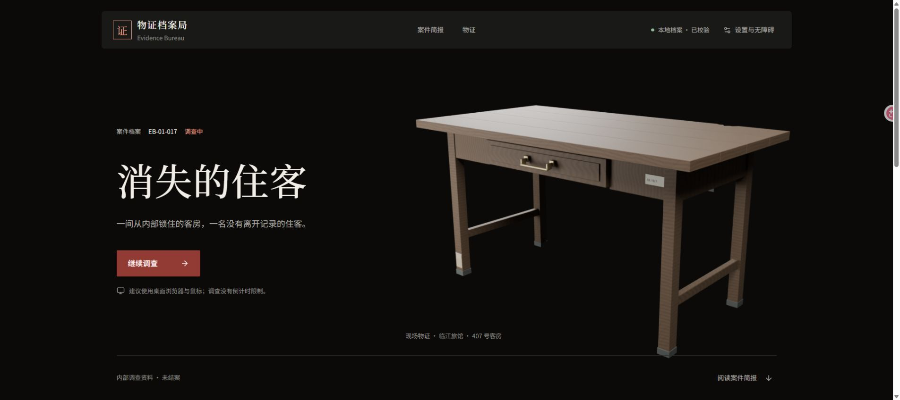
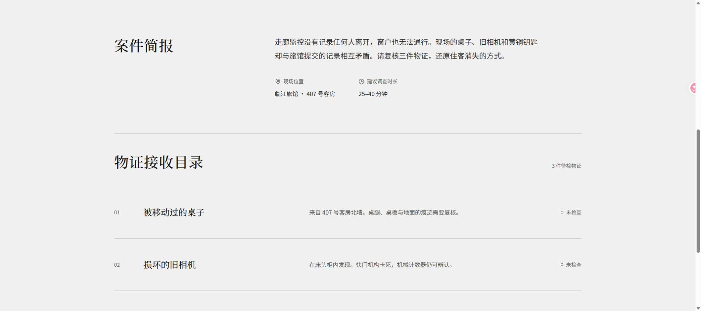
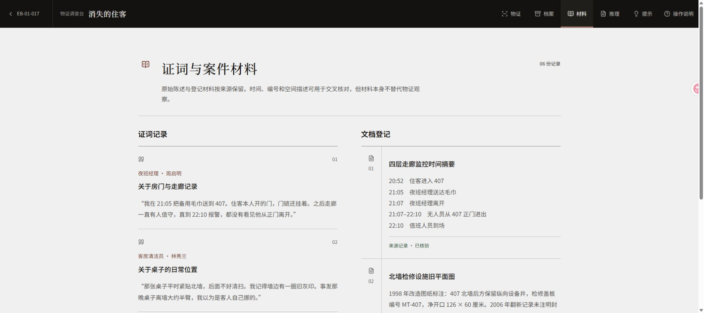
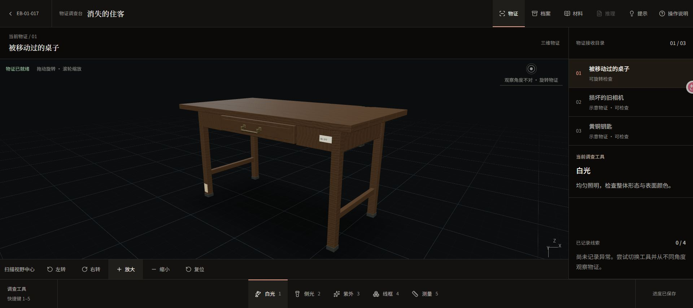
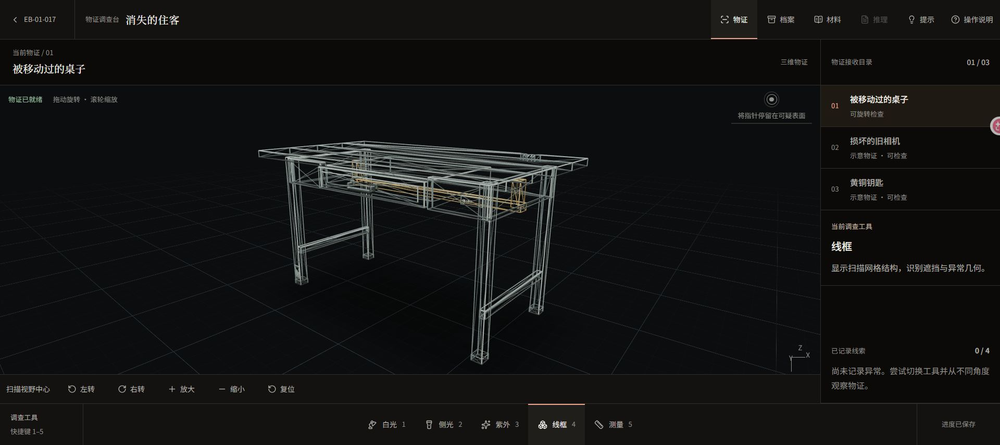
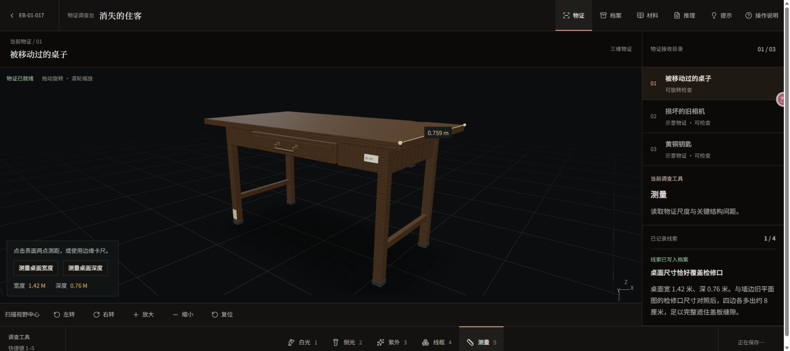

# 物证档案局（Evidence Bureau）

一款以 3D 物证观察、线索归档和证据链推理为核心的浏览器调查游戏。第一宗案件为《消失的住客》。

**[在线试玩](https://evidence-bureau.vercel.app/)** · [直接进入调查台](https://evidence-bureau.vercel.app/#/cases/vanished-tenant/investigation)

建议使用支持 WebGL 2 的桌面浏览器。无需注册，调查进度自动保存在当前浏览器；不同设备和浏览器之间不会同步。

默认开启「轻松调查」：点击右侧「定位并检查」，工具和视角会自动准备好，再点击物证上的标记记录线索。每件物证收集两条关键线索后，跟随「继续下一步」推进；推理页逐项确认已有证据支持的判断，最后整理证据并结案。原有存档可以直接继续。

想自行探索时，关闭右侧「轻松调查」，即可使用原有的表面观察、测量和手动连线。其余痕迹仍可自由收集，并计入线索完整度。

## 界面预览

目前桌子已接入独立的 Blender 静态模型；相机、钥匙暂时使用代理几何。以下图片均截自实际运行的网页。

### 案件档案

入口采用整屏物证主视觉，向下分段阅读案情与物证目录。中文宋体标题配合黑体正文，字体随站点发布，无需外部字体服务。



### 案件简报与物证目录

浅色阅读区通过字号、栏位和留白区分案情、现场信息及三件物证，保留直接进入调查的入口。



### 证词与案件材料

证词和文档分栏阅读，原始时间、编号与描述可相互核对。



### 三维物证调查

旋转、缩放物证，在不同光照下检查表面细节，并将发现写入线索档案。



### 线框检查

透过表面查看物证的内部结构，核对后加装的部件。



### 实际尺寸测量

支持表面两点测距和桌面边缘卡尺，测量结果来自加载模型的实际几何。



## 开发环境

- Node.js 22.12 或更高版本
- pnpm 9.15.9

```bash
pnpm install
pnpm dev
```

开发服务器默认运行在 `http://localhost:5173`。

## 质量检查

```bash
pnpm typecheck
pnpm lint
pnpm test:run
pnpm build
```

## 部署到 Vercel

项目为纯静态 Vite 应用，部署时使用以下设置：

| 设置             | 值                               |
| ---------------- | -------------------------------- |
| Framework Preset | Vite                             |
| Install Command  | `pnpm install --frozen-lockfile` |
| Build Command    | `pnpm build`                     |
| Output Directory | `dist`                           |

无需配置模型生成服务、数据库或环境变量。网页使用 Hash Router，案件地址中的 `#/cases/...` 可直接打开，不需要额外设置路由重写。物证模型随 `public/cases/` 一起发布。

产品需求见 `docs/requirements/PRODUCT_REQUIREMENTS.md`，系统设计见 `docs/architecture/SYSTEM_ARCHITECTURE.md`。

## 静态物证模型

桌子已使用本地 Blender 模型；相机、钥匙暂时保留代理几何。线上游戏只读取静态资源，不依赖模型生成服务器。

- 可编辑源文件：`assets/evidence/desk.blend`
- 网页资源：`public/cases/vanished-tenant/evidence/desk.glb`
- 重建脚本：`scripts/build-desk.py`，使用 Blender 4.5 LTS 制作，无外部素材依赖。

在项目根目录运行 `blender --background --factory-startup --python scripts/build-desk.py` 可重新生成源文件、GLB 和预览图。日常运行、构建网页不需要安装 Blender。

桌子使用米为单位，桌面宽 1.42 米、深 0.76 米。侧光下将指针停留在前侧左桌腿的擦痕上；背面的桌沿缺口需要旋转后查看；线框用于检查桌下后加装的横向支架。测量工具支持点击表面两点测距，也可使用宽度、深度卡尺；结果由加载模型的实际几何计算。
